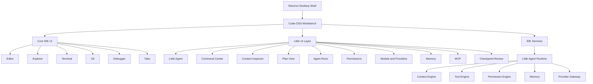
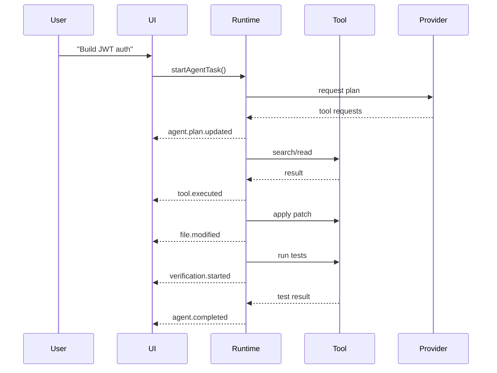

# Little Code — Frontend Architecture & UI Engineering Specification

**Product:** Little Code  
**Signature:** Built by Priyanshu Chaurasia  
**Document Type:** Frontend Architecture & UI Engineering Specification  
**Status:** Locked Baseline — v1.0  
**Companion Document:** Little Code Product Requirements Document (PRD)  
**Primary Platform:** Desktop  
**Primary IDE Foundation:** Code-OSS  
**Primary Cloud AI Provider:** Groq  
**Primary Local AI Runtime:** Ollama  

---

## 1. Purpose

This document defines the frontend architecture, UI engineering rules, design system, component boundaries, interaction patterns, animation language, and implementation strategy for **Little Code**.

The goal is to ensure that Little Code does not become merely a VS Code fork with an AI chat panel. The product must feel like a distinct, premium, AI-native development environment while retaining the reliability, compatibility, and mature editor capabilities inherited from Code-OSS.

This specification is the frontend source of truth for:

- workbench architecture
- native Code-OSS customization
- React usage
- component boundaries
- CSS architecture
- design tokens
- typography
- icons
- visual hierarchy
- agent UI
- context UI
- permission UI
- model/provider UI
- command center
- diff/review experiences
- motion system
- theme behavior
- accessibility
- performance
- testing
- implementation order

---

# 2. Frontend Product Goal

Little Code should feel like:

> **A calm, premium coding environment where AI activity is visible, understandable, and integrated into the development workflow rather than placed beside it.**

The product should visually communicate four ideas:

1. **Code is the primary workspace.**
2. **Little is an active collaborator, not a chatbot.**
3. **Agent actions are transparent and reversible.**
4. **The interface remains calm even during complex autonomous work.**

---

# 3. Core Frontend Decision

## Locked Architecture

Little Code will use:

- **Electron**
- **Code-OSS**
- **TypeScript**
- **native Code-OSS DOM/workbench architecture for core IDE surfaces**
- **React 19 for Little-specific interactive AI surfaces**
- **CSS custom properties and design tokens as the primary styling system**
- **CSS Modules where component isolation is useful**
- **Tailwind only selectively inside isolated React surfaces**
- **Motion for selected React animations**
- **custom SVG assets for Little-specific product icons**
- **existing mature editor infrastructure for editor, terminal, Git, debugger, LSP, tabs, and file explorer**

The product will **not** rebuild the entire editor in React.

---

# 4. Why This Architecture

Code-OSS already solves years of difficult IDE engineering:

- text editor behavior
- file management
- syntax highlighting
- language services
- debug adapters
- extension APIs
- terminal integration
- workspace handling
- Git integration
- keyboard navigation
- accessibility
- themes
- command registration
- window management

Little Code should spend engineering effort on its differentiator:

- agent runtime UX
- context management
- planning
- permissions
- model routing
- checkpoints
- semantic execution views
- verification
- AI-native workflows

---

# 5. High-Level Frontend Architecture



---

# 6. UI Technology Boundary

A major engineering rule is that every UI surface must have a clear ownership model.

## 6.1 Native Code-OSS Surfaces

These should remain close to Code-OSS architecture:

- editor
- tabs
- breadcrumbs
- activity bar base
- explorer tree
- search results
- terminal
- debug console
- problems
- output panel
- Git source control base
- keyboard shortcuts
- command infrastructure
- workbench layout
- extension host integration
- menus
- status bar infrastructure

These may be visually restyled and selectively extended.

They should not be rewritten in React without a strong architectural reason.

---

## 6.2 React-Powered Little Surfaces

React is recommended for complex, stateful, Little-specific experiences:

- Little Agent Panel
- Agent Composer
- Plan View
- Agent Run Inspector
- Context Inspector
- Model Selector
- Provider Manager
- MCP Manager
- Project Memory Viewer
- Permission Dialog
- Checkpoint Manager
- Usage Dashboard
- Agent History
- Onboarding
- Welcome/Home Screen
- workflow configuration
- advanced agent settings
- semantic tool-result cards

---

# 7. Recommended Frontend Stack

| Layer | Technology |
|---|---|
| Desktop Runtime | Electron |
| IDE Foundation | Code-OSS |
| Primary Language | TypeScript |
| Editor | Code-OSS / Monaco-derived editor |
| Core Workbench UI | DOM + TypeScript + CSS |
| Custom AI UI | React 19 |
| Styling | CSS variables + design tokens |
| Scoped Styling | CSS Modules where appropriate |
| Utility Styling | Selective Tailwind |
| Motion | Motion |
| Icons | Custom SVG + utility icon library |
| Code Font | JetBrains Mono |
| UI Font | Inter |
| Brand Font | Space Grotesk |
| State | local stores + event-driven runtime state |
| Desktop IPC | Code-OSS/Electron service boundaries |
| Testing | Vitest/Jest + Playwright where appropriate |

---

# 8. Design Philosophy

Little Code must avoid two common mistakes:

### Mistake 1 — “AI carnival”

Too many gradients, glowing cards, animations, particles, and badges make a coding tool distracting.

### Mistake 2 — “VS Code recolor”

Changing blue to purple and adding a chat panel is not a new product identity.

The desired direction is:

> **Minimal structural UI + strong semantic AI components + restrained branded motion.**

---

# 9. Brand Identity

## Product Name

**Little Code**

## Signature

**Built by Priyanshu Chaurasia**

## Logo Concept

A geometric lowercase **L** with a floating intelligent node.

The mark represents:

- Little
- code
- cursor
- agent
- execution
- context
- activity

The node becomes part of the product's motion language.

---

# 10. Color System

## 10.1 Foundation

```css
:root {
  --little-bg-canvas: #090B10;
  --little-bg-primary: #0E1118;
  --little-bg-panel: #131721;
  --little-bg-raised: #181D29;
  --little-bg-hover: #1E2432;

  --little-border-subtle: #272E3D;
  --little-border-strong: #343D51;

  --little-text-primary: #F5F7FB;
  --little-text-secondary: #B4BDCC;
  --little-text-muted: #7D8799;
  --little-text-disabled: #515969;
}
```

---

## 10.2 Brand Accents

```css
:root {
  --little-violet: #8B5CF6;
  --little-cyan: #22D3EE;
  --little-rose: #EC4899;
}
```

Signature gradient:

```css
:root {
  --little-agent-gradient:
    linear-gradient(
      135deg,
      #8B5CF6 0%,
      #22D3EE 52%,
      #EC4899 100%
    );
}
```

---

## 10.3 Semantic Colors

Recommended semantic tokens:

```css
:root {
  --little-success: #34D399;
  --little-warning: #FBBF24;
  --little-danger: #FB7185;
  --little-info: #60A5FA;
}
```

These colors are functional.

Brand gradients should never replace semantic status colors where clarity is important.

---

# 11. Gradient Usage Rules

Use gradients for:

- Little logo node
- agent active state
- selected agent mode
- primary onboarding action
- command center focus
- AI activity indicator
- special progress visualization

Do not use gradients for:

- every button
- file explorer rows
- editor backgrounds
- terminal backgrounds
- all borders
- every card
- ordinary settings

The gradient should communicate **intelligence/activity**, not decoration.

---

# 12. Typography

## 12.1 Brand Font

**Space Grotesk**

Used for:

- logo wordmark
- splash screen
- major headings
- onboarding hero
- dashboard titles

---

## 12.2 UI Font

**Inter**

Used for:

- labels
- menus
- buttons
- settings
- dialogs
- panels
- navigation
- agent metadata

---

## 12.3 Editor Font

Default:

**JetBrains Mono**

Optional user-selectable fonts:

- Geist Mono
- Fira Code
- Cascadia Code
- system monospace
- custom installed fonts

---

# 13. Type Scale

Suggested baseline:

| Usage | Size |
|---|---:|
| Hero title | 32–40px |
| Major view title | 24px |
| Panel heading | 16–18px |
| Body UI | 13–14px |
| Secondary metadata | 11–12px |
| Editor | 13–15px |
| Status bar | 11–12px |

The IDE must prioritize information density without becoming visually cramped.

---

# 14. Spacing System

Use a 4px base grid.

Recommended tokens:

```text
4px
8px
12px
16px
20px
24px
32px
40px
48px
```

Primary components should avoid arbitrary spacing values.

---

# 15. Radius System

Recommended:

```text
Small        6px
Default      8px
Card         12px
Large        16px
Pill         999px
```

Avoid overly rounded “mobile app” styling.

The product should still feel like professional desktop software.

---

# 16. Border Philosophy

Little Code should use borders sparingly.

Preferred hierarchy:

1. background contrast
2. spacing
3. subtle border
4. stronger border only for focus or separation

Avoid bright panel outlines.

---

# 17. Shadow and Glow System

Normal panels:

- little or no shadow

Raised dialogs:

- soft shadow

AI active state:

- restrained violet/cyan glow

The glow must never reduce code readability.

---

# 18. Icon System

## 18.1 Custom Little Icons

Custom icons should be created for:

- Little Agent
- Agent Run
- Context
- Memory
- Checkpoint
- MCP
- Autopilot
- Model Router
- Agent Status
- Workflow
- Project Intelligence

These help build product identity.

---

## 18.2 Utility Icons

Use an existing icon system for:

- folders
- files
- search
- close
- chevrons
- copy
- settings
- play
- stop
- warning
- common Git actions

Do not design hundreds of commodity icons manually.

---

# 19. Little Logo Motion System

The floating node becomes the application's signature animation.

## Idle

Static node.

## Thinking

Slow pulse.

## Searching

Small lateral motion or orbit.

## Planning

Rhythmic pulse.

## Executing

Controlled moving node.

## Waiting for Permission

Amber pulse.

## Success

Short cyan completion pulse.

## Failure

Short red pulse.

Animations must be subtle and limited.

---

# 20. Animation Timing

Recommended durations:

```text
Micro interaction     100–160ms
Panel transition      180–240ms
Dialog transition     180–220ms
Agent status          250–450ms
Success animation     <700ms
```

Long looping animations should be avoided except subtle agent-state indicators.

---

# 21. Reduced Motion

Little Code must honor:

```text
prefers-reduced-motion
```

When enabled:

- disable unnecessary transitions
- disable node movement
- replace motion with static state changes
- retain semantic state indicators

---

# 22. Main Window Layout

Default desktop layout:

```text
┌─────────────────────────────────────────────────────────────────────┐
│ Little Code     project-name                      Little ●  Run   ⚙ │
├───────┬───────────────────────────────────────────┬─────────────────┤
│       │                                           │                 │
│ ACT.  │                  EDITOR                   │  LITTLE AGENT   │
│ BAR   │                                           │                 │
│       │                                           │                 │
│       │                                           │                 │
├───────┼───────────────────────────────────────────┴─────────────────┤
│       │                    TERMINAL / OUTPUT                         │
└───────┴─────────────────────────────────────────────────────────────┘
```

The right panel should remain hideable.

The editor must remain visually dominant.

---

# 23. Top Bar

Little Code should modernize the top bar while preserving desktop usability.

Concept:

```text
[Little Icon] Little Code   project-name        Agent ●   Run   Git   ⚙
```

Traditional menus remain accessible via:

- application menu
- keyboard shortcuts
- command center

The top bar should not become visually overloaded.

---

# 24. Activity Bar

Recommended groups:

```text
Explorer
Search
Source Control
Run & Debug
Extensions

────────────

Little
Agent Runs
Memory
MCP
```

Little-specific icons may receive subtle accent treatment.

---

# 25. Editor Tabs

Goals:

- slightly more breathing room than default VS Code
- minimal borders
- clear active tab
- subtle active indicator
- dirty state
- agent-modified state

Potential AI marker:

```text
auth.ts     •
```

where the marker indicates unsaved or agent-modified state depending on chosen UI semantics.

Do not overload tabs with badges.

---

# 26. Editor Surface

The editor itself should remain calm.

Little Code branding must not interfere with:

- syntax colors
- selection
- diagnostics
- inline diffs
- cursor visibility
- line numbers

Agent-specific additions may include:

- inline change markers
- agent change gutter
- context annotations
- checkpoint diff indicators

---

# 27. Little Agent Panel

This is the primary product-differentiating UI.

It should not look like a generic chat application.

Structure:

```text
┌──────────────────────────────────┐
│ Little Agent              ● Idle │
│                                  │
│ Ask  Plan  Edit  Agent           │
│                                  │
│ Conversation / semantic cards    │
│                                  │
│                                  │
│ ┌──────────────────────────────┐ │
│ │ Ask Little...                │ │
│ │                              │ │
│ │ @workspace     Agent    ↑    │ │
│ └──────────────────────────────┘ │
└──────────────────────────────────┘
```

---

# 28. Agent Modes UI

Modes:

- Ask
- Plan
- Edit
- Agent
- Autopilot

Only the modes implemented in the current release should be visible.

The selected mode should receive restrained brand accent.

Mode selection must explain capability changes.

Example:

```text
Agent
Can read, edit files, and run approved tools.
```

---

# 29. Agent Composer

The composer should support:

- multiline prompts
- file/folder attachments
- context chips
- model selection
- mode selection
- image attachments later
- command shortcuts
- stop button
- submit button

Suggested structure:

```text
┌───────────────────────────────────────┐
│ Ask Little to build something...     │
│                                       │
│ @workspace  @auth  @git-diff         │
│                                       │
│ Agent ▼    Groq · model ▼       ↑    │
└───────────────────────────────────────┘
```

---

# 30. Semantic Agent Messages

Avoid rendering every action as plain conversational text.

Use dedicated components.

## Plan Card

```text
PLAN

✓ Understand architecture
● Implement service
○ Add endpoint
○ Add tests
○ Verify
```

## File Change Card

```text
FILE CHANGE

auth.service.ts
+48  -12

[View Diff]
```

## Terminal Card

```text
COMMAND

npm test

✓ 42 tests passed
3.4s
```

## Permission Card

```text
PERMISSION REQUIRED

npm install jsonwebtoken

Reason:
Required for JWT support.

[Allow Once] [Always Allow] [Reject]
```

## Verification Card

```text
VERIFICATION

✓ TypeScript
✓ ESLint
✓ Tests
✓ Build
```

This semantic component system is central to Little Code's professional appearance.

---

# 31. Agent Activity Timeline

The product should show useful execution activity without exposing hidden model reasoning.

Example:

```text
✓ Indexed workspace
✓ Located authentication flow
✓ Read user model
● Editing middleware.ts
○ Run tests
○ Review diff
```

Do not display chain-of-thought.

Display actions, tool calls, results, and structured summaries.

---

# 32. Agent Run Inspector

Dedicated view for substantial tasks.

Sections:

- goal
- status
- model
- start time
- duration
- context usage
- files changed
- commands executed
- permissions requested
- checkpoints
- plan
- verification
- final diff
- final summary

Example:

```text
BUILD AUTHENTICATION

Status: Executing
Provider: Groq
Model: selected-model

Progress
5 / 8 steps

Files changed     6
Commands          4
Context            41K

Current:
Running authentication tests

[Stop]
```

---

# 33. Plan View

Plans must support:

- hierarchical steps
- status indicators
- expandable details
- file references
- current step
- failed step
- skipped step
- manual reorder later
- pause/resume later

Statuses:

```text
pending
active
complete
failed
skipped
blocked
```

---

# 34. Context UI

Little Code must make context visible.

Context chips:

```text
@workspace
@auth.ts
@terminal
@git-diff
@docs
```

Context Inspector should show:

- source
- size
- why included
- relevance
- token estimate
- ability to remove
- automatic/manual origin

Example:

```text
Current Context

Workspace Map          4.2K
auth.service.ts        7.1K
user.model.ts          3.4K
Git Diff               2.1K
Agent Memory           1.8K

Estimated Total       18.6K
```

---

# 35. Command Center

Keyboard shortcut recommendation:

```text
Ctrl/Cmd + Shift + Space
```

The Command Center combines:

- command palette
- AI prompt
- file navigation
- symbol navigation
- model switcher
- agent actions
- workflows

Example:

```text
┌─────────────────────────────────────────┐
│ ◈ What do you want to do?              │
│                                         │
│ >                                       │
│                                         │
│ Ask Little                              │
│ Build a feature                         │
│ Search workspace                        │
│ Open file                               │
│ Run command                             │
│ Change model                            │
│ Start agent                             │
└─────────────────────────────────────────┘
```

This should become a signature Little Code interaction.

---

# 36. Diff and Review Experience

AI-generated edits must be easy to inspect.

Required actions:

- Accept hunk
- Reject hunk
- Accept file
- Reject file
- Accept all
- Reject all
- Restore checkpoint
- Ask Little to revise selected change

Agent-generated changes should be visually distinguishable from ordinary Git changes.

---

# 37. Inline AI Editing

Shortcut recommendation:

```text
Ctrl/Cmd + K
```

Flow:

1. select code
2. open compact inline input
3. describe change
4. generate patch
5. preview inline diff
6. accept/reject

Keep the interaction fast.

Do not open the full agent panel for small edits unless requested.

---

# 38. Permission UX

Permission prompts must state:

- requested action
- why
- target
- expected impact
- risk level
- available choices

Example:

```text
Little wants to execute:

npm install passport jsonwebtoken

Reason:
Required for authentication implementation.

Changes:
package.json
package-lock.json

[Allow Once]
[Always Allow Package Installs]
[Reject]
```

Destructive operations should have stronger visual hierarchy.

---

# 39. Security UI States

Risk levels:

```text
Safe
Workspace Change
Execution
Sensitive
Dangerous
```

Do not rely only on color.

Always include text/icon status.

---

# 40. Model Selector

Model selection should be elegant and understandable.

Example:

```text
Groq
● Model A                 Fast
○ Model B                 Strong
○ Model C                 Long Context

Local
○ Qwen Coder              Ollama
○ Devstral                Ollama
```

Potential capability chips:

```text
Tools
Vision
Reasoning
Fast
Local
```

---

# 41. Provider Manager

Provider screen:

```text
AI Providers

Groq                     Connected ●
API Key                  •••••••••
Models                   5 available

Ollama                   Running ●
Endpoint                 localhost:11434

OpenAI                   Not configured
Anthropic                Not configured
Gemini                   Not configured

+ Add Provider
```

Credentials must be handled through secure storage.

---

# 42. MCP Manager

MCP screen should show:

- connected servers
- server status
- tools
- resources
- permissions
- connection settings
- errors

Example:

```text
MCP Servers

GitHub                  Connected
12 tools

PostgreSQL              Connected
8 tools

Browser                 Disabled

+ Add MCP Server
```

---

# 43. Memory Viewer

Project Memory should be inspectable.

Categories:

- project architecture
- commands
- conventions
- dependencies
- user preferences
- decisions
- learned facts

Each memory should show provenance if possible.

Users must be able to remove or correct memory.

---

# 44. Checkpoint UI

Checkpoint view:

```text
Checkpoint #14

Before:
Authentication implementation

Files captured       7
Git state            clean
Created              2 min ago

[View Changes]
[Restore]
```

Restore actions should clearly explain what will be reverted.

---

# 45. Terminal Integration

Agent commands should be visually tagged.

Example:

```text
Little Agent

$ npm test

PASS auth.test.ts
PASS user.test.ts

42 passed
```

Show:

```text
Initiated by Little
```

Automated execution should never be visually indistinguishable from human execution.

---

# 46. Problems and Diagnostics

Agent-generated changes should integrate with diagnostics.

Example:

```text
Problems: 3

auth.ts
TS2322

Little:
I introduced this type mismatch while changing the refresh flow.

[Fix]
```

The agent should be able to consume diagnostics directly.

---

# 47. Git UX

Little-specific Git experiences:

- Explain Diff
- Review Agent Changes
- Generate Commit Message
- Suggest Branch Name
- Resolve Conflict
- Summarize Commit
- Prepare Commit

Git push should require explicit permission by default.

---

# 48. Welcome Screen

Empty workspace:

```text
              [Little Logo]

               Little Code

         What are we building today?

        [Open Project] [Clone Repo]

             Start with Little
```

Keep minimal.

Avoid dashboard clutter during first run.

---

# 49. Repository Onboarding

When a repository opens:

```text
Understanding project...

✓ 418 files
✓ React + TypeScript
✓ Node backend
✓ PostgreSQL
✓ Vitest
✓ Git repository

Little understands the project.

[Ask Little]
```

Indexing must not block normal editing.

---

# 50. Settings Architecture

Recommended categories:

```text
General
Appearance
Editor
AI Providers
Models
Agent
Context
Memory
Permissions
MCP
Terminal
Git
Extensions
Privacy
Advanced
```

Little-specific settings should use custom React surfaces where they significantly improve usability.

---

# 51. Theme Architecture

Little Code should support:

- default dark theme
- future light theme
- high contrast mode
- user themes where compatible

The default branded theme is:

**Little Dark / Neo Aurora**

Theme values should be mapped through semantic tokens.

Never hardcode brand colors deeply inside components.

---

# 52. Light Theme Strategy

A future light theme should not simply invert the dark theme.

It should use:

- warm off-white canvas
- pale graphite surfaces
- restrained gradient accents
- high-contrast text
- reduced glow
- subtle shadow

The agent node remains branded.

---

# 53. Design Token Architecture

Recommended token hierarchy:

```text
primitive
↓
semantic
↓
component
```

Example:

```text
violet-500
↓
accent-agent
↓
agent-status-active
```

This prevents visual inconsistency.

---

# 54. Component Architecture

Recommended structure:

```text
src/little/
├── ui/
│   ├── components/
│   │   ├── Button/
│   │   ├── IconButton/
│   │   ├── Dialog/
│   │   ├── Tooltip/
│   │   ├── Dropdown/
│   │   ├── SegmentedControl/
│   │   ├── Badge/
│   │   ├── Progress/
│   │   └── EmptyState/
│   │
│   ├── tokens/
│   ├── icons/
│   ├── motion/
│   └── themes/
│
├── agent-ui/
├── command-center/
├── context-ui/
├── model-ui/
├── provider-ui/
├── permissions-ui/
├── memory-ui/
├── mcp-ui/
├── checkpoint-ui/
└── onboarding/
```

---

# 55. Component Rules

Reusable components must:

- use semantic tokens
- support keyboard navigation
- support focus states
- support dark/light themes
- support high contrast where feasible
- avoid provider-specific assumptions
- avoid hardcoded model names
- avoid direct backend calls where a service exists

---

# 56. State Architecture

Not all product state belongs in React.

## UI Local State

Examples:

- dropdown open
- selected tab
- expanded section
- temporary input

## Product State

Examples:

- current agent run
- current model
- permissions
- provider status
- context selection
- active checkpoint

Product state should come from the Little runtime/service layer.

---

# 57. Event-Driven UI

Little runtime should emit structured events.

Examples:

```text
agent.started
agent.state.changed
agent.plan.updated
tool.requested
tool.approved
tool.executed
file.modified
checkpoint.created
verification.started
verification.failed
agent.completed
```

The frontend listens and renders appropriate semantic components.

---

# 58. Example Agent UI Event Flow



---

# 59. IPC Boundary

The UI must not directly execute privileged operations.

Correct:

```text
React UI
↓
Frontend Service
↓
Little Runtime
↓
Permission Engine
↓
Tool
```

Incorrect:

```text
React Button
↓
shell.exec()
```

This is a critical security boundary.

---

# 60. Error Handling UX

Errors should be contextual.

Bad:

```text
Something went wrong.
```

Better:

```text
Groq request failed.

Reason:
Rate limit reached.

Little can:
• retry shortly
• switch model
• switch provider

[Retry]
[Change Model]
```

---

# 61. Loading UX

Avoid generic full-screen spinners.

Use contextual states:

```text
Indexing repository…
Connecting to Groq…
Retrieving context…
Running tests…
Waiting for approval…
```

Large operations should expose progress when available.

---

# 62. Offline UX

If cloud provider is unavailable:

```text
Groq is unavailable.

Local Ollama models detected:
• Qwen Coder
• Devstral

[Use Local Model]
```

Offline status should be clear but not alarming.

---

# 63. Performance Requirements

## UI

Interactions should feel immediate.

Target common UI interactions:

```text
<100ms perceived response where possible
```

## Agent streaming

Display streamed output/events immediately.

## Search

Text search should remain responsive for normal repositories.

## Indexing

Incremental and background.

Never freeze editor typing.

## React

Avoid rendering huge file trees or editor surfaces in React unnecessarily.

---

# 64. React Performance Rules

- memoize expensive derived views
- virtualize long lists
- avoid global rerenders
- subscribe to narrow runtime state
- batch high-frequency agent events
- avoid storing massive source files in React state
- do not mirror the entire repository in frontend memory

---

# 65. Accessibility

Required baseline:

- keyboard navigation
- visible focus states
- screen reader labels
- logical tab order
- semantic buttons
- text alternatives for icons
- reduced motion
- adequate contrast
- non-color-only status communication

AI features should not make accessibility worse than the base IDE.

---

# 66. Keyboard-First Design

Little Code is a developer tool.

Important actions must have keyboard access.

Suggested shortcuts:

```text
Ctrl/Cmd + Shift + Space    Little Command Center
Ctrl/Cmd + K                Inline AI Edit
Ctrl/Cmd + L                Focus Little Agent
Escape                      Stop/close current lightweight interaction
```

Final shortcuts must be checked against existing Code-OSS conflicts.

---

# 67. Responsive Desktop Behavior

Little Code is primarily desktop software.

However, it must support:

- narrow windows
- ultrawide monitors
- multiple editor groups
- hidden side panels
- docked bottom panel
- resizable agent panel

Agent panel should collapse gracefully.

---

# 68. Multi-Monitor Behavior

Dialogs should anchor to the active application window.

Agent activity must remain associated with the correct workspace.

Never assume one screen.

---

# 69. High-DPI Support

Brand assets should be SVG where possible.

Avoid raster UI assets for:

- icons
- logo
- controls

The interface should remain crisp on high-DPI displays.

---

# 70. Agent Trust UX

Users must always understand:

- what Little is doing
- what it wants to do next
- what changed
- what commands ran
- what verification passed
- what still failed

Trust is a frontend requirement, not only a backend requirement.

---

# 71. Privacy Indicators

When content is sent to a cloud provider, the UI should be able to communicate provider context.

Example:

```text
Using Groq Cloud
```

Local:

```text
Using Ollama · Local
```

This distinction should be visible near model selection.

---

# 72. Secret Warning UI

If sensitive content is detected:

```text
Potential secret detected

.env appears to contain credentials.

This content may be sent to Groq.

[Redact]
[Allow Once]
[Cancel]
```

Do not hide security decisions behind generic confirmations.

---

# 73. Usage and Cost UI

Optional view:

```text
Today

Requests            84
Input Tokens        324K
Output Tokens        47K

Groq
Model A             ...

Ollama
Local Runs          12
```

Avoid misleading users into thinking local computation is literally free in every sense; distinguish API cost from local compute.

---

# 74. Agent History

Agent runs should be searchable.

Example:

```text
Today

✓ Build JWT authentication
✓ Fix cart checkout bug
× Upgrade Prisma schema
✓ Generate API tests
```

Each run opens its full inspector.

---

# 75. Notification Philosophy

Avoid excessive toast notifications.

Use notifications for:

- task complete when panel is hidden
- permission required
- fatal provider issue
- agent failure
- important update

Routine tool calls should stay in the agent timeline.

---

# 76. Toast Design

Toasts should be:

- compact
- dismissible
- keyboard accessible
- non-blocking
- semantically colored

Example:

```text
✓ Little finished
Authentication implementation passed all tests.

[Review]
```

---

# 77. Empty States

Every major custom screen needs a designed empty state.

Example Memory:

```text
No project memory yet.

Little will learn useful project conventions
as you work.

[Learn about Memory]
```

Empty states should teach, not merely state absence.

---

# 78. First-Run Onboarding

Recommended flow:

```text
Welcome
↓
Choose appearance
↓
Connect Groq
↓
Detect Ollama
↓
Choose default model
↓
Choose agent permission level
↓
Open project
```

Do not force users to configure every advanced feature.

---

# 79. Default Permission Profiles

Offer understandable presets:

### Safe

- read automatically
- ask before writes
- ask before commands

### Balanced

- workspace writes allowed
- safe commands allowed
- sensitive operations ask

### Power User

- broad workspace autonomy
- dangerous operations still ask

Users can customize later.

---

# 80. Visual QA Rules

Every major screen must be checked at:

- 100% scaling
- 125% scaling
- 150% scaling
- narrow window
- large monitor
- dark theme
- high contrast mode

---

# 81. Testing Strategy

## Component Tests

For Little React components.

## Interaction Tests

For:

- model selection
- permissions
- context attachment
- agent status
- checkpoint restore

## End-to-End Tests

Important flows:

```text
launch Little Code
open workspace
connect provider
ask repository question
start agent
approve tool
inspect diff
stop agent
restore checkpoint
```

---

# 82. Visual Regression Testing

Recommended for:

- Little Agent
- Permission Dialog
- Model Selector
- Command Center
- Context Inspector
- Checkpoint View
- Welcome Screen

This protects the design system from accidental drift.

---

# 83. Code Quality Rules

Frontend code should:

- use TypeScript strict mode where practical
- avoid `any`
- separate UI from execution logic
- keep provider logic outside UI
- use shared token definitions
- use reusable semantic components
- avoid giant monolithic components
- document non-obvious Code-OSS integration patches

---

# 84. CSS Rules

Do:

```css
background: var(--little-bg-panel);
color: var(--little-text-primary);
```

Avoid:

```css
background: #131721;
color: #F5F7FB;
```

except inside primitive token definitions.

---

# 85. Tailwind Policy

Tailwind is allowed only where it improves development speed without creating two conflicting design systems.

Recommended use:

- isolated React prototypes
- onboarding
- dashboard-style surfaces

Avoid using Tailwind to style the entire native Code-OSS workbench.

The token system remains authoritative.

---

# 86. Motion Policy

Motion is used to communicate:

- change
- progress
- state
- hierarchy
- agent activity

Motion is not used for:

- decorative background movement
- constant glowing
- excessive panel bouncing
- animated editor chrome

---

# 87. Little Code Frontend Folder Proposal

```text
src/
└── little/
    ├── core/
    │   ├── services/
    │   ├── events/
    │   ├── types/
    │   └── ipc/
    │
    ├── ui/
    │   ├── components/
    │   ├── icons/
    │   ├── tokens/
    │   ├── themes/
    │   ├── motion/
    │   └── utilities/
    │
    ├── agent-ui/
    ├── context-ui/
    ├── command-center/
    ├── model-ui/
    ├── provider-ui/
    ├── permission-ui/
    ├── checkpoint-ui/
    ├── memory-ui/
    ├── mcp-ui/
    ├── history-ui/
    ├── onboarding/
    └── welcome/
```

---

# 88. UI Data Contracts

Example agent run summary:

```ts
interface AgentRunViewModel {
  id: string;
  title: string;
  status:
    | 'idle'
    | 'understanding'
    | 'planning'
    | 'waiting_permission'
    | 'executing'
    | 'verifying'
    | 'repairing'
    | 'completed'
    | 'failed'
    | 'cancelled';

  provider: string;
  model: string;

  startedAt: number;
  completedAt?: number;

  filesChanged: number;
  commandsExecuted: number;

  currentStep?: AgentStepViewModel;
  plan: AgentPlanViewModel;
  verification?: VerificationViewModel;
}
```

---

# 89. Tool Card Contract

```ts
interface ToolCallViewModel {
  id: string;
  toolName: string;
  category: 'file' | 'search' | 'terminal' | 'git' | 'mcp' | 'browser';
  status: 'pending' | 'running' | 'success' | 'failed';
  summary: string;
  durationMs?: number;
  requiresApproval: boolean;
  outputPreview?: string;
}
```

The UI should render tool cards from structured data, not raw model text.

---

# 90. Permission Contract

```ts
interface PermissionRequestViewModel {
  id: string;
  action: string;
  reason: string;
  riskLevel: 'safe' | 'workspace' | 'execution' | 'sensitive' | 'dangerous';
  target?: string;
  impact?: string[];
  choices: PermissionChoice[];
}
```

---

# 91. Context Contract

```ts
interface ContextItemViewModel {
  id: string;
  label: string;
  type: 'workspace' | 'file' | 'symbol' | 'terminal' | 'git' | 'memory' | 'mcp';
  source: 'automatic' | 'manual';
  estimatedTokens: number;
  relevance?: number;
  removable: boolean;
}
```

---

# 92. Theme Contract

All Little components should consume semantic theme values rather than direct colors.

Conceptual:

```ts
interface LittleTheme {
  background: {
    canvas: string;
    primary: string;
    panel: string;
    raised: string;
  };

  text: {
    primary: string;
    secondary: string;
    muted: string;
  };

  accent: {
    agent: string;
    cyan: string;
    violet: string;
    rose: string;
  };
}
```

---

# 93. MVP Frontend Scope

The frontend MVP must include:

## Workbench

- Little Code branding
- dark theme
- custom top bar treatment
- custom Little activity item
- right-side Little Agent panel

## Agent

- Ask mode
- Plan mode
- Agent mode
- streaming messages
- structured activity
- plan card
- tool cards
- stop control

## Context

- context chips
- active-file context
- workspace context
- basic context inspector

## Models

- Groq provider settings
- model selector
- provider status

## Permissions

- command approval
- file-write approval if configured
- dangerous-action warning

## Changes

- agent modification indicator
- diff review
- accept/reject
- basic checkpoint restore

## Onboarding

- welcome screen
- Groq setup
- open project

---

# 94. MVP Frontend Non-Goals

Do not delay MVP for:

- full workflow builder
- marketplace
- multi-agent visual orchestration
- collaboration
- cloud dashboard
- fancy 3D visuals
- animated backgrounds
- custom GPU renderer
- complete icon redesign of Code-OSS
- mobile UI
- browser-based IDE

---

# 95. Phase 2 Frontend

Add:

- Ollama model management
- persistent memory viewer
- agent history
- advanced context inspector
- usage dashboard
- MCP manager
- inline edits
- enhanced checkpoint timeline
- custom commands
- advanced provider settings

---

# 96. Phase 3 Frontend

Add:

- browser agent viewer
- screenshot/vision workflows
- multi-agent run visualization
- workflow builder
- skill manager
- remote development status
- advanced debugging assistant

---

# 97. Key UI Differentiators

Little Code should be recognizable because of:

1. **Little agent node**
2. **semantic agent activity cards**
3. **Command Center**
4. **visible context inspector**
5. **clear permission architecture**
6. **agent run timeline**
7. **checkpoint-based review**
8. **restrained violet/cyan/rose intelligence accents**
9. **calm graphite workbench**
10. **model/provider transparency**

---

# 98. Design Acceptance Criteria

The frontend is considered visually successful when:

- users can distinguish Little Code from VS Code at a glance
- the editor remains calm and readable
- AI activity is visually distinct but not distracting
- agent actions are understandable without reading raw logs
- permissions feel trustworthy
- model/provider state is visible
- context is inspectable
- rollback is easy to discover
- no core workflow requires a mouse
- the interface remains usable on smaller laptop screens
- the product feels consistent across native and React surfaces

---

# 99. Engineering Acceptance Criteria

The frontend architecture is considered sound when:

- React does not replace mature Code-OSS editor infrastructure
- privileged actions pass through the runtime/permission layer
- UI components use semantic design tokens
- agent events are structured
- provider details are abstracted from most UI components
- custom Little surfaces can evolve without deeply coupling to editor internals
- the workbench remains responsive during agent execution
- an agent run can be stopped safely
- UI state can recover after restart
- model changes do not require frontend rewrites

---

# 100. Locked Frontend Decision

Little Code will use:

> **Electron + Code-OSS + TypeScript as the desktop IDE foundation, native Code-OSS workbench technologies for core editor surfaces, and React 19 for Little-specific AI experiences.**

The UI will be driven by:

> **semantic design tokens, custom CSS architecture, restrained motion, custom Little branding, structured agent components, visible context, transparent permissions, and a calm premium developer-first visual language.**

The goal is not to imitate VS Code, Cursor, Zed, or JetBrains.

The goal is to use a proven editor foundation while making the **interaction model, agent experience, visual identity, and development workflow unmistakably Little Code.**

---

# 101. Final Frontend Architecture

```text
                           LITTLE CODE
                  Built by Priyanshu Chaurasia

                                  │
                                  ▼

                    ELECTRON DESKTOP SHELL
                                  │
                                  ▼
                         CODE-OSS WORKBENCH
                                  │
              ┌───────────────────┼───────────────────┐
              │                   │                   │
              ▼                   ▼                   ▼
        CORE IDE UI          LITTLE UI           IDE SERVICES
        TypeScript           React 19            LSP / Debug
        DOM / CSS            TypeScript          Terminal / Git
        Monaco               Tokens              Extensions
                             Motion
              │                   │                   │
              └───────────────────┼───────────────────┘
                                  │
                                  ▼
                         LITTLE RUNTIME API
                                  │
                ┌─────────────────┼─────────────────┐
                ▼                 ▼                 ▼
           Agent Runtime     Context Engine    Permission Engine
                │                 │                 │
                └─────────────────┼─────────────────┘
                                  │
                                  ▼
                          TOOL + MODEL LAYER
                                  │
              ┌───────────────────┼───────────────────┐
              ▼                   ▼                   ▼
            Groq               Ollama                MCP
```

---

# 102. Frontend Philosophy

Every frontend decision should pass these tests:

### Does it help the developer understand what Little is doing?

### Does it keep code as the center of attention?

### Does it make autonomous actions safer and easier to review?

### Does it preserve speed and keyboard-first workflows?

### Does it strengthen Little Code's visual identity without becoming distracting?

If the answer is no, the UI element probably does not belong in the product.

---

## Little Code

**Your AI-native coding companion.**

**Built by Priyanshu Chaurasia**
